

<picture><source media="(prefers-color-scheme: dark)" srcset="assets/dark/hero.svg"></picture>

I run <a href="https://flickerlink.com"><b>Flickerlink Technologies</b></a>, a founder-led studio.
Most of my work sits close to the metal: KVM hosts, XDP/eBPF packet filters, Rust control planes,
and the panels that make all of it feel like one button. Plus a few native iOS apps.

<a href="https://clouduxe.com"><picture><source media="(prefers-color-scheme: dark)" srcset="assets/dark/chip-clouduxe.svg"></picture></a>
<a href="https://flickerlink.com"><picture><source media="(prefers-color-scheme: dark)" srcset="assets/dark/chip-flickerlink.svg"></picture></a>
<a href="https://fiveuxe.com"><picture><source media="(prefers-color-scheme: dark)" srcset="assets/dark/chip-fiveuxe.svg"></picture></a>
<a href="mailto:vinayak.gandhi.in@gmail.com"><picture><source media="(prefers-color-scheme: dark)" srcset="assets/dark/chip-email.svg"></picture></a>

  

<picture><source media="(prefers-color-scheme: dark)" srcset="assets/dark/section-building.svg"></picture>

<a href="https://clouduxe.com"><picture><source media="(prefers-color-scheme: dark)" srcset="assets/dark/card-clouduxe.svg"></picture></a>
<a href="https://clouduxe.com/ddos-protection"><picture><source media="(prefers-color-scheme: dark)" srcset="assets/dark/card-prism.svg"></picture></a>
 
<a href="https://clouduxe.com/media-storage"><picture><source media="(prefers-color-scheme: dark)" srcset="assets/dark/card-fxvault.svg"></picture></a>
<a href="https://fiveuxe.com"><picture><source media="(prefers-color-scheme: dark)" srcset="assets/dark/card-fiveuxe.svg"></picture></a>

  

<picture><source media="(prefers-color-scheme: dark)" srcset="assets/dark/section-open-source.svg">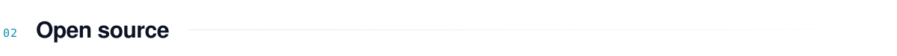</picture>

<a href="https://github.com/Vinayak0090/sediment"><picture><source media="(prefers-color-scheme: dark)" srcset="assets/dark/repo-sediment.svg"></picture></a>
<a href="https://github.com/Vinayak0090/git-undo"><picture><source media="(prefers-color-scheme: dark)" srcset="assets/dark/repo-git-undo.svg"></picture></a>
 
<a href="https://github.com/Vinayak0090/lockwise"><picture><source media="(prefers-color-scheme: dark)" srcset="assets/dark/repo-lockwise.svg"></picture></a>
<a href="https://github.com/Vinayak0090/fivem-sentinel"><picture><source media="(prefers-color-scheme: dark)" srcset="assets/dark/repo-fivem-sentinel.svg"></picture></a>

  

<picture><source media="(prefers-color-scheme: dark)" srcset="assets/dark/section-stack.svg">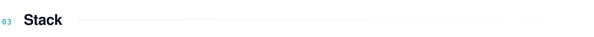</picture>

<picture><source media="(prefers-color-scheme: dark)" srcset="assets/dark/stack.svg">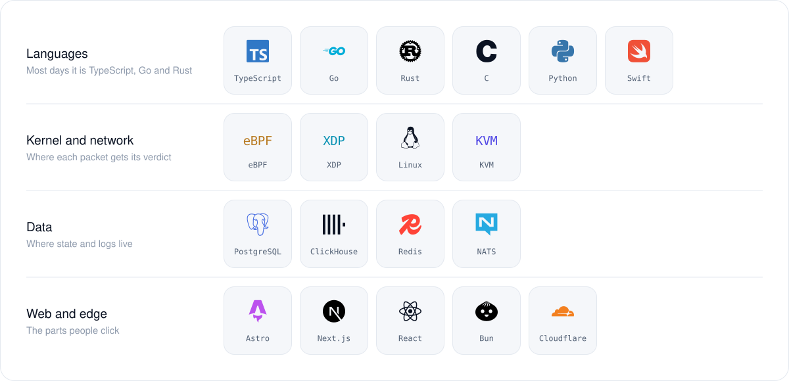</picture>

  

<picture><source media="(prefers-color-scheme: dark)" srcset="assets/dark/section-activity.svg"></picture>

<picture><source media="(prefers-color-scheme: dark)" srcset="assets/dark/stats.svg"></picture>

<picture><source media="(prefers-color-scheme: dark)" srcset="assets/dark/footer.svg"></picture>

