<picture><source media="(prefers-color-scheme: dark) and (max-width: 640px)" srcset="assets/dark/hero.m.svg"><source media="(max-width: 640px)" srcset="assets/light/hero.m.svg"><source media="(prefers-color-scheme: dark)" srcset="assets/dark/hero.svg"></picture>

These days: XDP/eBPF filters, Rust and Go, 
and a storage engine built from scratch. 
I run Flickerlink Technologies 
and make native iOS apps on the side.

<a href="https://www.linkedin.com/in/vinayakgandhi/"><picture><source media="(prefers-color-scheme: dark)" srcset="assets/dark/chip-linkedin.svg"></picture></a>
<a href="mailto:vinayak.gandhi.in@gmail.com"><picture><source media="(prefers-color-scheme: dark)" srcset="assets/dark/chip-email.svg"></picture></a>
<a href="https://flickerlink.com"><picture><source media="(prefers-color-scheme: dark)" srcset="assets/dark/chip-flickerlink.svg"></picture></a>

  

<picture><source media="(prefers-color-scheme: dark) and (max-width: 640px)" srcset="assets/dark/h-open-source.m.svg"><source media="(max-width: 640px)" srcset="assets/light/h-open-source.m.svg"><source media="(prefers-color-scheme: dark)" srcset="assets/dark/h-open-source.svg"></picture>

<a href="https://github.com/Vinayak0090/sediment"><picture><source media="(prefers-color-scheme: dark) and (max-width: 640px)" srcset="assets/dark/repo-sediment.m.svg"><source media="(max-width: 640px)" srcset="assets/light/repo-sediment.m.svg"><source media="(prefers-color-scheme: dark)" srcset="assets/dark/repo-sediment.svg"></picture></a>
<a href="https://github.com/Vinayak0090/git-undo"><picture><source media="(prefers-color-scheme: dark) and (max-width: 640px)" srcset="assets/dark/repo-git-undo.m.svg"><source media="(max-width: 640px)" srcset="assets/light/repo-git-undo.m.svg"><source media="(prefers-color-scheme: dark)" srcset="assets/dark/repo-git-undo.svg"></picture></a>
 
<a href="https://github.com/Vinayak0090/lockwise"><picture><source media="(prefers-color-scheme: dark) and (max-width: 640px)" srcset="assets/dark/repo-lockwise.m.svg"><source media="(max-width: 640px)" srcset="assets/light/repo-lockwise.m.svg"><source media="(prefers-color-scheme: dark)" srcset="assets/dark/repo-lockwise.svg"></picture></a>
<a href="https://github.com/Vinayak0090/fivem-sentinel"><picture><source media="(prefers-color-scheme: dark) and (max-width: 640px)" srcset="assets/dark/repo-fivem-sentinel.m.svg"><source media="(max-width: 640px)" srcset="assets/light/repo-fivem-sentinel.m.svg"><source media="(prefers-color-scheme: dark)" srcset="assets/dark/repo-fivem-sentinel.svg"></picture></a>

  

<picture><source media="(prefers-color-scheme: dark) and (max-width: 640px)" srcset="assets/dark/h-work.m.svg"><source media="(max-width: 640px)" srcset="assets/light/h-work.m.svg"><source media="(prefers-color-scheme: dark)" srcset="assets/dark/h-work.svg"></picture>

<a href="https://clouduxe.com/ddos-protection"><picture><source media="(prefers-color-scheme: dark) and (max-width: 640px)" srcset="assets/dark/prism.m.svg"><source media="(max-width: 640px)" srcset="assets/light/prism.m.svg"><source media="(prefers-color-scheme: dark)" srcset="assets/dark/prism.svg"></picture></a>

<a href="https://clouduxe.com"><picture><source media="(prefers-color-scheme: dark) and (max-width: 640px)" srcset="assets/dark/clouduxe.m.svg"><source media="(max-width: 640px)" srcset="assets/light/clouduxe.m.svg"><source media="(prefers-color-scheme: dark)" srcset="assets/dark/clouduxe.svg"></picture></a>

<a href="https://clouduxe.com/media-storage"><picture><source media="(prefers-color-scheme: dark) and (max-width: 640px)" srcset="assets/dark/fxvault.m.svg"><source media="(max-width: 640px)" srcset="assets/light/fxvault.m.svg"><source media="(prefers-color-scheme: dark)" srcset="assets/dark/fxvault.svg"></picture></a>
<a href="https://fiveuxe.com"><picture><source media="(prefers-color-scheme: dark) and (max-width: 640px)" srcset="assets/dark/fiveuxe.m.svg"><source media="(max-width: 640px)" srcset="assets/light/fiveuxe.m.svg"><source media="(prefers-color-scheme: dark)" srcset="assets/dark/fiveuxe.svg"></picture></a>

  

<picture><source media="(prefers-color-scheme: dark) and (max-width: 640px)" srcset="assets/dark/h-stack.m.svg"><source media="(max-width: 640px)" srcset="assets/light/h-stack.m.svg"><source media="(prefers-color-scheme: dark)" srcset="assets/dark/h-stack.svg"></picture>

<picture><source media="(prefers-color-scheme: dark) and (max-width: 640px)" srcset="assets/dark/stack.m.svg"><source media="(max-width: 640px)" srcset="assets/light/stack.m.svg"><source media="(prefers-color-scheme: dark)" srcset="assets/dark/stack.svg"></picture>

  

<picture><source media="(prefers-color-scheme: dark) and (max-width: 640px)" srcset="assets/dark/h-activity.m.svg"><source media="(max-width: 640px)" srcset="assets/light/h-activity.m.svg"><source media="(prefers-color-scheme: dark)" srcset="assets/dark/h-activity.svg"></picture>

<picture><source media="(prefers-color-scheme: dark) and (max-width: 640px)" srcset="assets/dark/activity.m.svg"><source media="(max-width: 640px)" srcset="assets/light/activity.m.svg"><source media="(prefers-color-scheme: dark)" srcset="assets/dark/activity.svg"></picture>

<picture><source media="(prefers-color-scheme: dark) and (max-width: 640px)" srcset="assets/dark/footer.m.svg"><source media="(max-width: 640px)" srcset="assets/light/footer.m.svg"><source media="(prefers-color-scheme: dark)" srcset="assets/dark/footer.svg"></picture>

